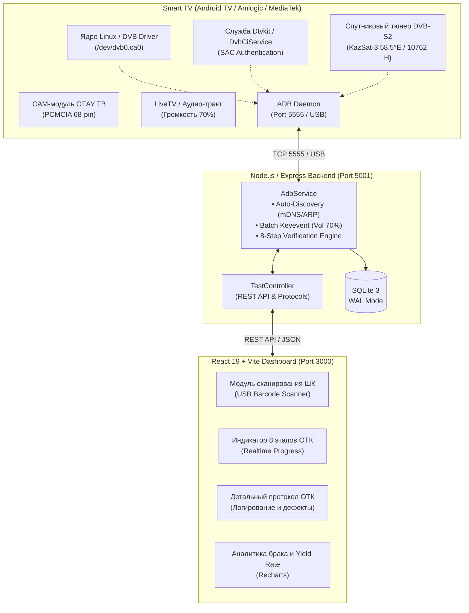

# QMS-CI Test Station (Автоматизированный стенд проверки слотов DVB-CI / CI+ и тюнера DVB-S2)

[](https://react.dev/)
[](https://www.typescriptlang.org/)
[](https://nodejs.org/)
[](https://expressjs.com/)
[](https://www.sqlite.org/)
[](https://developer.android.com/studio/command-line/adb)
[](LICENSE)

Промышленный программно-аппаратный комплекс автоматизации контроля качества (**ОТК / Quality Assurance**) для конвейерного и стендового тестирования телевизоров **Smart TV** на базе **Android TV / Google TV** (платформы Amlogic, MediaTek и др.).

Стенд производит **100% автоматическую валидацию** разъема PCMCIA DVB-CI/CI+, спутникового тракта DVB-S/S2, криптографического дескремблера и выполняет автодобавление телеканалов ОТАУ ТВ с контрольным включением звука на уровне 70% **без необходимости покупки платных подписок или абонплаты операторов**.

---

## 📌 Ключевые возможности

- **100% аппаратная и криптографическая валидация CI/CI+ (v1.3, v1.4, v2.0):**
  - Проверка целостности всех 68 пинов разъема PCMCIA и линий питания (5V/3.3V).
  - Считывание отклика контроллера слота ядра Android (`/dev/dvb0.ca0` / `/dev/dvb/adapter0/ca0`).
  - Проверка взаимной аутентификации CAM-модуля и хоста (SAC — Secure Authenticated Channel).
  - Сквозная проверка шины Transport Stream (TS) и дескремблера на закодированном потоке.
- **Диагностика спутникового тракта и кабеля LNB IN (KazSat-3 58.5°E):**
  - Проверка физического подключения антенного кабеля LNB к гнезду Satellite.
  - Измерение мощности (Signal Strength, %), качества (Signal Quality, %), отношения сигнал/шум (SNR, dB) и частоты битовых ошибок (BER = 0).
- **Автоматическая настройка базового пакета каналов ОТАУ ТВ (30 каналов):**
  - Автоматическое добавление частоты `10762 H 30000` (КазСат-3 58.5°E) — государственного мультиплекса Казахстана (*Qazaqstan HD, Khabar HD, Balapan, El Arna, Qazsport HD, Jibek Joly, Хабар 24, Первый канал Евразия, МИР, Астана ТВ, КТК, 31 Канал, НТК* и др.).
  - Исключение сторонних и мусорных операторов, что устраняет переполнение памяти ТВ и проблему «черного экрана».
- **Контрольное включение эфира со звуком 70%:**
  - Пакетное и точное выставление громкости динамиков ТВ ровно на **70%** за 300 мс (`setSpeakerVolumeTo70`).
  - Автоматический вывод приложения LiveTV с рабочим каналом для мгновенной слуховой и визуальной оценки сотрудником ОТК.
- **Smart ADB Auto-Discovery (Подключение без ручного ввода IP):**
  - Автоматическое сканирование локальной сети (Wi-Fi / Ethernet) через mDNS-сервисы, опрос ARP-таблицы и параллельный probe порта 5555.
  - Мгновенное автоподключение к подключенному ТВ как по кабелю USB, так и по сети.
- **Интеграция с лазерными USB-сканерами 1D/2D:**
  - Автофокус на поле ввода серийного номера, триггер теста по нажатию `[ENTER]` сканера.
- **База данных SQLite 3 в режиме WAL:**
  - Высокая скорость записи результатов испытаний, защита от повреждений при отключении питания конвейера, хранение полных технических журналов ADB.
- **Интерактивная аналитическая панель (Recharts):**
  - Уровень годных (Yield Rate), распределение дефектов, почасовой тренд выявления брака.

---

## 🏗 Архитектура системы



---

## 🔍 8 Этапов проверки ОТК

| № | Этап | Описание проверки | Норма для PASS |
|---|---|---|---|
| **1** | **ADB Connection** | Подключение к ТВ по сети или USB, считывание модели и серийного номера | Код устройства и модель получены |
| **2** | **Logcat Reset** | Очистка буфера логов, активация интерфейса `com.mitv.livetv.ci_mediatek` | Буфер готов к записи |
| **3** | **Hardware CI Slot** | Проверка регистрации узла `/dev/dvb0.ca0`, питания 5V/3.3V и контактов PCMCIA | Символьный узел найден в ядре |
| **4** | **CI+ Authentication** | Проверка сессии SAC, криптографического рукопожатия и сертификатов | `AUTH_SUCCESS` |
| **5** | **CAM Module Info** | Извлечение CIS-дескрипторов (производитель, версия, профиль) | Модуль идентифицирован |
| **6** | **Satellite Signal LNB** | Проверка кабеля LNB IN: уровень, качество, BER на частоте KazSat-3 | Сигнал > 30%, BER = 0, LOCKED |
| **7** | **Auto-Add Channels** | Автонастройка базового пакета ОТАУ ТВ (частота 10762 H 30000) | Залочено, найдено 30 каналов |
| **8** | **Volume 70% & Broadcast** | Выставление звука на 70% и запуск LiveTV для физического контроля | Громкость = 70%, канал активен |

---

## 📁 Структура проекта

```
ci-card-test-stand/
├── backend/                         # Серверная часть (Node.js + TypeScript + Express)
│   ├── src/
│   │   ├── config/
│   │   │   └── database.ts          # Инициализация SQLite 3, WAL-режим, миграции
│   │   ├── controllers/
│   │   │   ├── adbController.ts     # Управление подключением, автопоиск ТВ в сети
│   │   │   ├── statsController.ts   # Агрегация аналитики для графиков Recharts
│   │   │   └── testController.ts    # Запуск теста, формирование истории и протоколов
│   │   ├── routes/
│   │   │   ├── adbRoutes.ts         # Эндпоинты /api/adb/*
│   │   │   ├── statsRoutes.ts       # Эндпоинты /api/stats/*
│   │   │   └── testRoutes.ts        # Эндпоинты /api/tests/*
│   │   ├── services/
│   │   │   └── adbService.ts        # Ядро стенда: ADB-драйвер, 8 этапов, звук 70%, парсеры
│   │   └── server.ts                # Точка входа сервера Express (порт 5001)
│   ├── package.json
│   └── tsconfig.json
│
├── frontend/                        # Клиентская часть (React 19 + TypeScript + Vite)
│   ├── public/                      # Статические ресурсы и SVG-иконки
│   ├── src/
│   │   ├── components/
│   │   │   ├── Header.tsx           # Верхняя панель (статус ADB, подключенный ТВ, часы смены)
│   │   │   ├── ScannerTestTrigger.tsx # Поле сканера ШК, автопоиск ТВ, тумблер транспондеров
│   │   │   ├── LiveProcessSteps.tsx # Пошаговая индикация 8 этапов тестирования
│   │   │   ├── ResultCard.tsx       # Финальный баннер вердикта ГОДЕН / БРАК с кодом ошибки
│   │   │   ├── StatsCharts.tsx      # Графики Yield Rate, структуры брака и трендов
│   │   │   ├── RecentTestsTable.tsx # Журнал последних проверок с поиском и фильтром
│   │   │   ├── TestDetailModal.tsx  # Карточка теста с плашками параметров и действиями ОТК
│   │   │   └── LogViewerModal.tsx   # Просмотр сырого и расшифрованного отчета ADB
│   │   ├── services/
│   │   │   └── api.ts               # HTTP-клиент Axios для общения с бэкендом
│   │   ├── store/
│   │   │   └── useTestStore.ts      # Глобальное реактивное состояние (Zustand)
│   │   ├── App.tsx                  # Компоновка главного экрана оператора
│   │   ├── index.css                # Темная индустриальная тема оформления
│   │   └── main.tsx
│   ├── index.html
│   ├── vite.config.ts
│   └── tsconfig.json
│
├── deploy/
│   └── qms-ci.service               # systemd unit-файл для автозапуска на Linux-стендах
├── docker/
│   ├── Dockerfile.backend           # Контейнер бэкенда с установленным android-tools-adb
│   ├── Dockerfile.frontend          # Nginx-контейнер для сборки и раздачи SPA
│   ├── docker-compose.yml           # Стек оркестрации
│   └── nginx.conf                   # Конфигурация обратного прокси Nginx
│
├── .gitignore                       # Исключение node_modules, WAL-файлов, дампов
├── LICENSE                          # Лицензия MIT (Izenov Nurbolat)
├── package.json                     # Корневой манипулятор для одновременного запуска
└── README.md                        # Полная техническая документация проекта
```

---

## 🚀 Быстрый запуск

### Системные требования:
- **Node.js**: версия 20.x или новее
- **ADB** (Android Debug Bridge): должен быть установлен в системе и доступен в `PATH`
- **ОС**: Linux (Ubuntu/Debian), macOS или Windows (с установленным ADB)

### 1. Клонирование и установка зависимостей:
```bash
git clone git@github.com:nrkfo/ci-card-test-stand.git
cd ci-card-test-stand

# Установка корневых и дочерних зависимостей
npm install
npm run install:all
```

### 2. Запуск в режиме разработки:
```bash
# Запуск бэкенда (порт 5001) и фронтенда (порт 3000) одной командой:
npm run dev
```

Откройте интерфейс в браузере: **http://localhost:3000**

---

## 🏭 Развертывание в производственной среде

### Вариант 1: Служба Linux systemd (Рекомендуется для стендов ОТК)

1. Скопируйте проект в рабочую директорию:
   ```bash
   sudo cp -r . /opt/ci-card-test-stand
   cd /opt/ci-card-test-stand
   npm install && npm run build
   ```

2. Установите права доступа:
   ```bash
   sudo chown -R otk:otk /opt/ci-card-test-stand
   ```

3. Активируйте службу:
   ```bash
   sudo cp deploy/qms-ci.service /etc/systemd/system/
   sudo systemctl daemon-reload
   sudo systemctl enable qms-ci
   sudo systemctl start qms-ci
   ```

### Вариант 2: Docker Compose

```bash
cd docker
docker-compose up -d --build
```
Интерфейс будет доступен на порту `80`, REST API — на порту `5001`.

---

## 📡 Спецификация REST API

### Запуск проверки ТВ
```http
POST /api/tests/run
Content-Type: application/json

{
  "targetIp": "192.168.211.114:5555",
  "autoScanTransponders": true,
  "serial_number": "SN-TV-63948C14",
  "model_name": "Xiaomi MiTV-AXFU1"
}
```

### Автопоиск ТВ в сети Wi-Fi / Ethernet
```http
GET /api/adb/scan-network
```
Возвращает список обнаруженных Android TV устройств с открытым портом 5555.

### Получение истории проверок
```http
GET /api/tests/recent?limit=50&offset=0
```

### Аналитическая сводка
```http
GET /api/stats/summary
```

---

## 👤 Автор и лицензия

- **Автор**: [Izenov Nurbolat (nrkfo)](https://github.com/nrkfo)
- **Email**: [nurik.wayne98@gmail.com](mailto:nurik.wayne98@gmail.com)
- **LinkedIn**: [iznm](https://linkedin.com/in/iznm)

Проект распространяется под лицензией **MIT License** — подробнее в файле [LICENSE](LICENSE).
